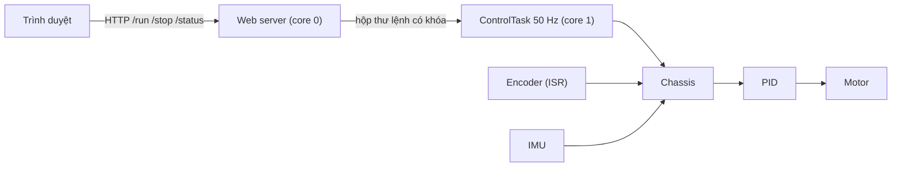

# Xe vi sai 3 bánh tự hành trên ESP32


Mobile robot vi sai (2 bánh chủ động và 1 bánh caster) chạy trên ESP32, lập trình C++ hướng đối tượng với PlatformIO và FreeRTOS. Xe được điều khiển qua một web server nội bộ (HTTP/JSON). Dự án dùng để học và đối chiếu bốn mô hình: **động học thuận, động học nghịch, động lực học thuận, động lực học nghịch**.

**Thành viên:** An Hoàng Anh · Trần Hải Nam · Nguyễn Công Thành

## Trạng thái

| Hạng mục | Trạng thái |
|---|---|
| Điều khiển cấp thấp (PWM, encoder, PID vận tốc bánh) | Đã có code |
| Odometry (encoder cho X, Y và IMU cho θ) | Đã có code, cần hiệu chuẩn trên xe thật |
| Web điều khiển 4 ô x 3 chế độ | Đã có code |
| Tune PID và feedforward | Đang thực hiện, xem [docs/tuning.md](docs/tuning.md) |
| Cảm biến siêu âm HC-SR04 | Có driver, chưa tích hợp vào vòng điều khiển |
| Tự hành (Pure Pursuit, bám tường) | Kế hoạch |

## Phần cứng

| Thành phần | Chi tiết |
|---|---|
| MCU | ESP32 (core 0: Wi-Fi/web, core 1: vòng điều khiển 50 Hz) |
| Động cơ | JGA25-370 280 RPM, driver L298N |
| Encoder | 11 xung, tỉ số truyền 21.3, giải mã 4X = 937.2 xung/vòng bánh |
| IMU | BMI160 (I2C 0x68), dùng gyro trục Z cho góc hướng |
| Siêu âm | 3 x HC-SR04 (trái, giữa, phải) |
| Hình học | Bán kính bánh 32.5 mm, khoảng cách hai bánh 184 mm |

Sơ đồ chân và lưu ý đấu nối: [docs/hardware.md](docs/hardware.md).

## Kiến trúc



Chi tiết các lớp, trạng thái và thứ tự xử lý mỗi chu kỳ: [docs/architecture.md](docs/architecture.md).

## Bắt đầu nhanh

Cần [PlatformIO](https://platformio.org/) (VS Code extension hoặc CLI).

```bash
git clone https://github.com/trannam1084/diffdrive-esp32-robot.git
cd diffdrive-esp32-robot

# 1. Tạo file cấu hình Wi-Fi (không bị commit)
cp include/secrets.example.h include/secrets.h
#    Mở include/secrets.h và đổi mật khẩu

# 2. Build và nạp
pio run -t upload

# 3. Xem log
pio device monitor
```

Kết nối điện thoại vào Wi-Fi của xe (mặc định chế độ Access Point) rồi mở **http://192.168.4.1**. Muốn xe nối Wi-Fi nhà, đặt `WIFI_AP_MODE false` và điền `STA_SSID`, `STA_PASS` trong `include/secrets.h`.

> **Lần đầu cấp nguồn:** để xe đứng yên vài giây cho IMU hiệu chuẩn gyro, nếu không góc θ sẽ bị trôi.

## Cách điều khiển bằng web

Chọn một trong 4 ô và một trong 3 chế độ, nhập 3 giá trị (hai thông số và thời gian chạy). Xe tự dừng khi hết thời gian.

| Ô | Nhập | Xe làm gì |
|---|---|---|
| Động học thuận | ω_R, ω_L (rad/s) | Tính V_m, ω_m từ hai bánh, PID bám vận tốc |
| Động học nghịch | V_m (m/s), ω_m (rad/s) | Tính vận tốc hai bánh từ V_m, ω_m |
| Động lực học thuận | τ_R, τ_L (N·m) | Mô phỏng phương trình gia tốc rồi PID bám theo |
| Động lực học nghịch | V_m, ω_m mục tiêu | Profile gia tốc, feedforward động lực học, PID bù |

Quy tắc theo chế độ (web và firmware cùng kiểm tra):

| Chế độ | Ô động học và động lực học thuận | Ô nghịch (V_m, ω_m) |
|---|---|---|
| Đi thẳng | hai giá trị bằng nhau và dương | V_m > 0, ω_m = 0 |
| Quay tại tâm | hai giá trị trái dấu | V_m = 0, ω_m ≠ 0 |
| Đi vòng cung | cả hai dương và khác nhau | V_m, ω_m > 0 và V_m > ω_m·L |

Danh sách endpoint và giới hạn nhập: [docs/api.md](docs/api.md).

## Công thức và code

Phương trình của từng mô hình được đối chiếu với hàm tương ứng trong [docs/kinematics-dynamics.md](docs/kinematics-dynamics.md).

## Cấu trúc thư mục

```
├── platformio.ini
├── include/
│   ├── Config.h            hằng số vật lý, pin, giới hạn
│   ├── WebPage.h           giao diện web (HTML nhúng trong PROGMEM)
│   └── secrets.example.h   mẫu thông tin Wi-Fi (secrets.h không commit)
├── lib/
│   ├── Chassis/            động học, động lực học, odometry, máy trạng thái
│   ├── Motor/  Encoder/  PID/  IMU/  HCSR04/
├── src/main.cpp            Wi-Fi, web server, ControlTask
├── docs/                   tài liệu chi tiết
└── tools/plot_telemetry.py vẽ log CSV khi tune PID
```

## Lộ trình

1. Hiệu chuẩn odometry (bán kính bánh, khoảng cách hai bánh, độ phân giải encoder).
2. Bám quỹ đạo bằng Pure Pursuit.
3. Tích hợp ba cảm biến siêu âm (task riêng, không chặn vòng điều khiển) để bám tường và giải mê cung.

## Đóng góp

Tạo nhánh từ `main`, mở Pull Request. CI sẽ build cả hai môi trường (`esp32dev`, `telemetry`). Khi báo lỗi hãy dùng mẫu issue và đính kèm số liệu đo nếu có.

## Giấy phép

MIT, xem [LICENSE](LICENSE). Đổi giấy phép nếu trường hoặc giảng viên yêu cầu khác.
